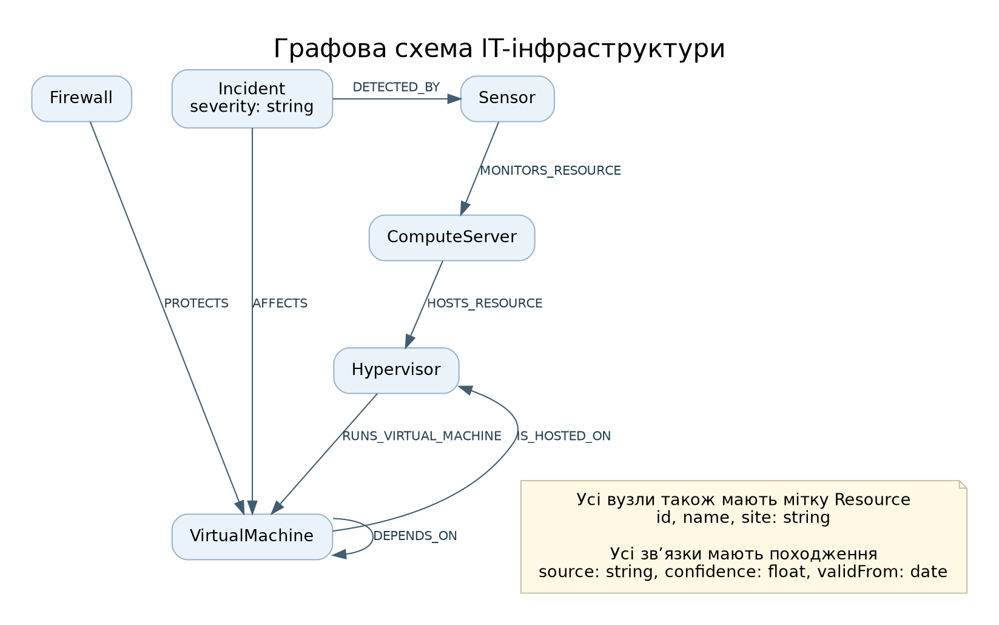

# Мапінг компетентнісних питань

*Рисунок 1. Мітки вузлів, зв’язки та властивості графа IT-інфраструктури.*

Вузли мають загальну мітку Resource та одну з шести предметних міток. Зв’язки мають source, confidence і validFrom. Для демонстрації source позначає правило генерації, а confidence 1.0 позначає точне відтворення цього правила. Це не оцінка надійності зовнішнього джерела.

Таблиця 1. Зіставлення CQ зі шляхами Cypher

| CQ | Питання | Шаблон | Колонки |
|---|---|---|---|
| 01 | Які ВМ працюють на srv_01 через гіпервізор? | `(:ComputeServer)-[:HOSTS_RESOURCE]->(:Hypervisor)-[:RUNS_VIRTUAL_MACHINE]->(:VirtualMachine)` | vm |
| 02 | Які сенсори моніторять srv_01? | `(:Sensor)-[:MONITORS_RESOURCE]->(:ComputeServer)` | sensor |
| 03 | Які інциденти high зачепили vm_02? | `(:Incident)-[:AFFECTS]->(:VirtualMachine)` | incident |
| 04 | Скільки різних інцидентів виявлено сенсорами кожного майданчика? | `(:Incident)-[:DETECTED_BY]->(:Sensor)` | site, incidents |
| 05 | Яка безпосередня залежність vm_01? | `(:VirtualMachine)-[:DEPENDS_ON]->(:VirtualMachine), OPTIONAL MATCH` | vm, dependency |
| 06 | Який найкоротший маршрут залежностей vm_01 → vm_05? | `shortestPath((a)-[:DEPENDS_ON*..6]->(b))` | route, hops |
| 07 | Які Firewall захищають vm_01 зі confidence ≥ 0.9 станом на 2026-11-18? | `(:Firewall)-[r:PROTECTS]->(:VirtualMachine), WHERE за confidence і validFrom` | firewall, source |
| 08 | Яка безпосередня залежність vm_05, якщо вона є? | `(:VirtualMachine)-[:DEPENDS_ON]->(:VirtualMachine), OPTIONAL MATCH` | vm, dependency |
| 09 | Від яких ВМ залежить vm_01 на глибині 1–4? | `(:VirtualMachine)-[:DEPENDS_ON*1..4]->(:VirtualMachine)` | dependency, depth |
| 10 | Які ВМ постраждають при відмові vm_05 на глибині 1–4? | `(:VirtualMachine)<-[:DEPENDS_ON*1..4]-(:VirtualMachine)` | affected, depth |

Таблиця 2. Зіставлення з онтологією ЛР07 за її звітом

| Елемент ЛР07 | Модель LPG | Пояснення |
|---|---|---|
| ComputeServer | Мітка ComputeServer | Фізичний обчислювальний сервер. |
| Hypervisor | Мітка Hypervisor | Середовище виконання ВМ. |
| VirtualMachine | Мітка VirtualMachine | Окремий вузол для аналізу залежностей. |
| Incident | Мітка Incident і властивість severity | Подія представлена вузлом. Критичність у демонстраційній моделі є властивістю. |
| Sensor | Мітка Sensor | Окремий вузол для моніторингу та фіксації інцидентів. |
| Firewall | Мітка Firewall | Вузол з окремими зв’язками захисту ВМ. |
| ITResource | Загальна технічна мітка Resource | Resource використовується для імпорту всіх вузлів, включно з Incident. Її семантика ширша за OWL-клас ITResource. |
| hostsResource, runsVirtualMachine | HOSTS_RESOURCE, RUNS_VIRTUAL_MACHINE | У LPG транзитивний обхід задається шляхом у запиті. |
| isHostedOn, monitorsResource | IS_HOSTED_ON, MONITORS_RESOURCE | Обернений зв’язок для runsVirtualMachine записаний явно в наборі. |
| hasIPAddress, hasCPUCount, hasRAMGB | Потенційні властивості вузлів | Ці властивості описані у ЛР07. CQ цієї демонстрації обходяться без них. |

PROTECTS, AFFECTS, DETECTED_BY і DEPENDS_ON використані для розширення демонстраційної схеми. Їхня наявність у початковому OWL не встановлена. SPARQL порівнюється на простому RDF-графі без OWL reasoner, тому автоматичні висновки ЛР07 не враховано.
