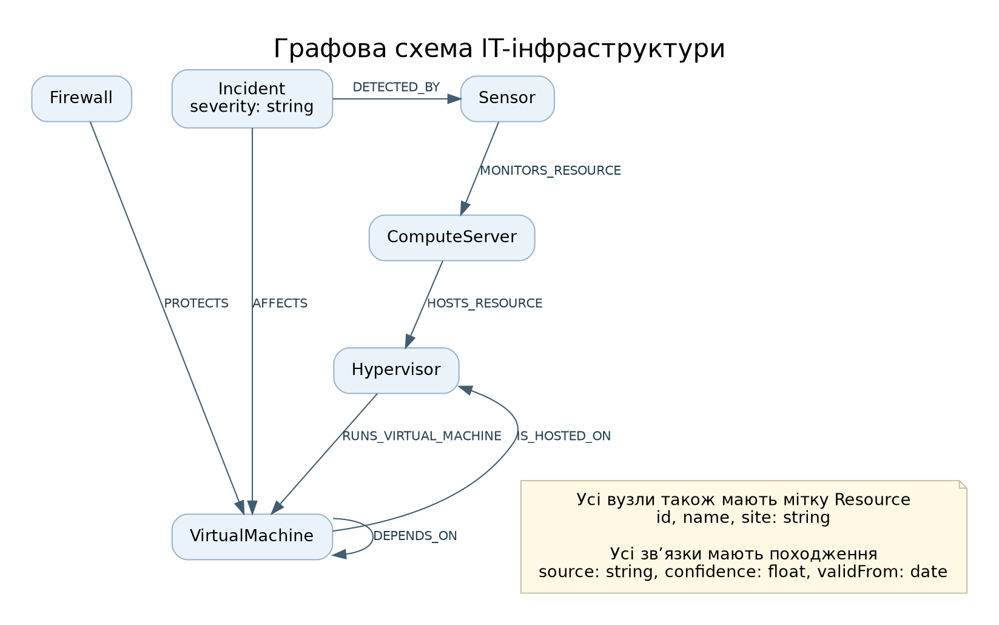

# Звіт до лабораторної роботи 9

Львівський національний університет імені Івана Франка  
Факультет електроніки та комп’ютерних технологій  
Кафедра системного проєктування

**Графова база знань у Neo4j**  
Дисципліна «Сховища знань та управління знаннями»  
Виконала Бундз Анастасія Олегівна, ФЕІ-43  
Перевірив(ла) ____________________  
Львів, 2026

## Мета і дані

Побудувати граф знань для управління IT-інфраструктурою, імпортувати його в Neo4j, перевірити Cypher-запити, виконати аналіз GDS та порівняти результати з SPARQL. Модель базується на описі онтології зі звіту ЛР07. Для контрольного запуску використано детермінований демонстраційний набір. Оригінальні файли даних ЛР 6–8 були недоступні.

## 1 Графова схема

Побудовано шість предметних міток і загальну мітку Resource. Граф має вісім типів зв’язків і три властивості походження для кожного ребра. Десять компетентнісних питань зіставлено із шаблонами шляхів. Деталі та порівняння з онтологією наведено в [мапінгу CQ](cq_mapping.md).

*Рисунок 1. Мітки, зв’язки та властивості графа.*

## 2 Імпорт та цілісність

Створено два обмеження унікальності та два окремі індекси. LOAD CSV і MERGE створили 120 вузлів та 216 зв’язків. Після повторного запуску кількості збіглися. Спроба вставити дубльований id завершилась помилкою обмеження. [Кількості та повідомлення Neo4j](import_results.md).

## 3 Запити до графа

Виконано 10 CQ. Запити охоплюють фільтри, WITH, агрегації, OPTIONAL MATCH, shortestPath і шляхи змінної довжини. CQ09 і CQ10 аналізують залежності в обох напрямках на глибині до чотирьох. Для CQ01, CQ03 і CQ06 виконано ручну перевірку. [Запити, результати та інтерпретації](cypher_results.md).

## 4 Аналіз графа і плани виконання

PageRank розраховано для всіх 120 вузлів. Алгоритм Louvain визначив 4 спільнот. Результати збережено у властивостях pagerank і community. PROFILE виконано для підрахунку вузлів майданчика і найкоротшого шляху. Підрахунок з індексом повернув ті самі рядки і змінив DB Hits з 361 до 31. [Топ-10, спільноти та плани](gds_report.md).

## 5 SPARQL і Text to Cypher

П’ять пар запитів Cypher та SPARQL дали однакові результати на еквівалентних демонстраційних даних. Десять кандидатів text-to-Cypher перевірено за еталоном із реальною роллю reader та обмеженням LIMIT. Контрольна частка правильних кандидатів становила 70%. У тест закладено три типові помилки. [Порівняння, час і аналіз помилок](sparql_vs_cypher.md).

## Декларація використання генеративного ШІ

ChatGPT (сімейство GPT‑6) допоміг підготувати графову схему, код і контрольні запити. Приклад завдання для моделі — «Перетвори кожне з десяти CQ на один Cypher 5 запит за наданою схемою». Підтверджено 6 з 10 тверджень (60%), відхилено 4. Причини наведено в [таблиці тверджень](../claims/claims.csv). [Журнал взаємодії](../llm_log/README.md).

## Висновок

Демонстраційний граф підтримує запити на моніторинг, інциденти та залежності між ВМ. Повторний імпорт зберігає кількості, а унікальні обмеження запобігають дублюванню ідентифікаторів. PageRank і Louvain доповнюють локальні CQ структурним аналізом. Для перенесення результатів на дані ЛР 6–8 потрібно імпортувати їх і повторити порівняння.

## Джерела

1. ЛР09 «Графова база знань у Neo4j», кафедра системного проєктування, 2026.
2. «Звіт до лабораторної роботи №7. Онтологія предметної області в Protégé та її формалізація», 2026.
3. [Neo4j Cypher Manual 5](https://neo4j.com/docs/cypher-manual/5/).
4. [Neo4j Graph Data Science Manual. PageRank](https://neo4j.com/docs/graph-data-science/current/algorithms/page-rank/).
5. [Neo4j Graph Data Science Manual. Louvain](https://neo4j.com/docs/graph-data-science/current/algorithms/louvain/).
6. [W3C SPARQL 1.1 Query Language](https://www.w3.org/TR/sparql11-query/).
